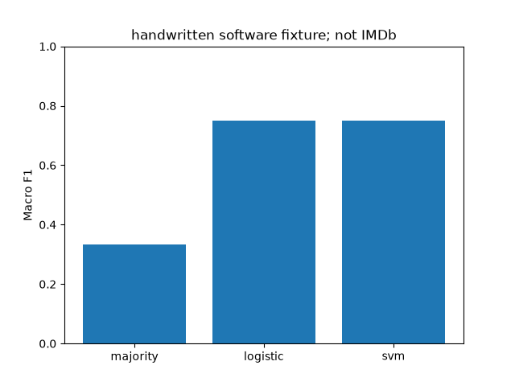
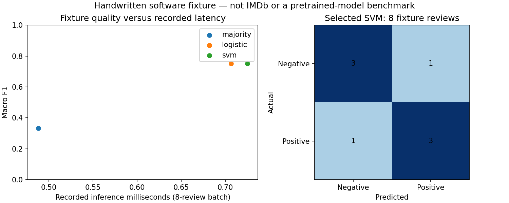
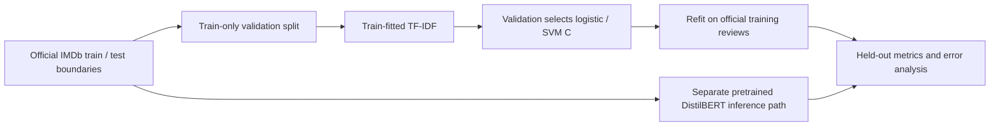

# Sentiment Classification — Classical Models & DistilBERT Pipeline

A tested comparison pipeline for majority baseline, TF-IDF logistic regression, TF-IDF linear SVM and explicitly pretrained DistilBERT inference. Models are shown in the demo only when their artifacts or inference path are available.

[](https://github.com/ayanirfan099/sentiment-classification-using-traditional-and-deep-learning-methods/actions/workflows/ci.yml)  [](LICENSE)




## Executed results
Executed the offline 32-review software fixture, including negation in test inputs. Fixture macro-F1: majority=0.3333, logistic=0.7500, svm=0.7500. These values are software checks, **not IMDb results**. Real dataset/pretrained comparisons and nuanced error analyses remain pending. [Measured fixture JSON](results/fixture/metrics.json).


## Reproduce


These are the committed eight-review test-fixture measurements, not IMDb or pretrained DistilBERT performance. Recreate this visualization with `python scripts/plot_fixture_diagnostics.py`; timings describe the original run and should not be compared across hardware.

From this repository root:
```bash
python -m pip install -e '.[dev]'
# Acquire Stanford IMDb from https://ai.stanford.edu/~amaas/data/sentiment/
python scripts/prepare_imdb.py data/aclImdb --output data/imdb.csv
python -m sentiment_study.cli --csv data/imdb.csv --transformer --output results/imdb
# Fully offline fixture run:
python -m sentiment_study.cli --csv tests/fixtures/reviews.csv --fixture --output results/fixture
streamlit run src/sentiment_study/app.py
pytest -q
ruff check .
ruff format --check .
```

## Research question and methodology
Preserve the official Stanford IMDb train/test directories when preparing CSV. Hold out 25% of official training reviews for C selection by macro-F1. Fit TF-IDF only on the training partition for model selection; refit chosen classical pipelines on all official train data, never official test. Default transformer checkpoint is distilbert/distilbert-base-uncased-finetuned-sst-2-english, pretrained/fine-tuned upstream on SST-2, not trained within this project. Truncate at 512 tokens and disclose loss of long-review context. Report document lengths, length groups, error positions, serialized classical sizes, model load/inference timing and transformer parameter bytes when executed.



## Implementation and review
`src/` contains the package and CLI; `tests/` contains CPU-safe unit and integration checks; `configs/` records defaults; `results/` stores measured metrics, not large datasets or checkpoints. See [methodology](docs/methodology.md), [reproducibility](docs/reproducibility.md), [status](docs/IMPLEMENTATION_STATUS.md), [quality review](docs/QUALITY_REVIEW.md) and [limitations](docs/limitations.md).

Four tests passed: invalid schema/labels/duplicates, seeded classical reproduction, no unseen-token vocabulary leakage, full fixture training/reload, CLI help, and offline tokenizer/checkpoint DistilBERT inference with repeated probability equality. Streamlit initial page rendering checked separately.

## Limitations and future work
IMDb and Hugging Face access returned proxy tunnel 403, so real IMDb and pretrained inference metrics are pending. Four transformer-path assertions use random tiny local DistilBERT weights, not a trained sentiment model. Optional fine-tuning is not implemented. Handwritten fixture has 24 train and 8 test reviews with deliberately simple vocabulary; its metrics cannot establish sentiment generalization. Short/long bins are descriptive, not tuned on test. Duplicate input texts are rejected conservatively; investigate provenance and deduplicate official training only before full IMDb execution without altering official test boundaries. No GPU or broad domain benchmark. User-upload browser interaction is untested.

## References and licensing
Maas et al. (2011), *Learning Word Vectors for Sentiment Analysis*, ACL, https://aclanthology.org/P11-1015/ . [Stanford IMDb dataset](https://ai.stanford.edu/~amaas/data/sentiment/), review its distribution terms before acquisition. Sanh et al. (2019), *DistilBERT*, arXiv:1910.01108. Default checkpoint model card on Hugging Face describes SST-2 training. No dataset or pretrained weights redistributed. Fixtures authored for software testing.

Repository code: MIT; third-party data, pretrained weights and libraries retain their own terms. No affiliations, publications or independent authorship claims are made.
